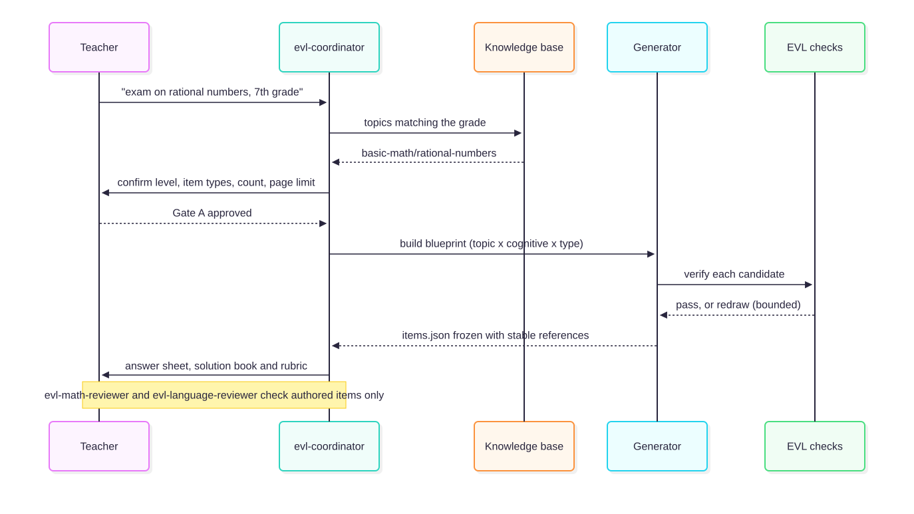

# @alisio/plugin-evalua

> Read this in [Spanish](./README.es.md). Both READMEs are kept in sync and must be updated together.

Evalúa helps a teacher prepare printable school math exams through a short, guided interview, with
answers and distractors computed by code and a page budget that is measured, never guessed.

> Status: v1 feature complete. The profile, workspace and interview, the exact math core, the
> extensible knowledge base, item generation and verification, and the end-to-end flow (Gate A →
> generate → build → Gate B) that writes the four documents as HTML and PDF are implemented and
> tested.

## Quick path

Install it persistently through Alisio:

```bash
alisio install npm:@alisio/plugin-evalua
```

Install a specific version, or update an installed plugin to a specific version:

```bash
alisio install npm:@alisio/plugin-evalua@0.2.1
alisio install npm:@alisio/plugin-evalua@0.2.1 --update
```

`alisio install --update` (without a spec) refreshes every installed plugin.

For project-local development instead:

```bash
npm install --save-dev @alisio/plugin-evalua
alisio --plugin @alisio/plugin-evalua
```

Requires Node 22.16 or newer and `@alisio/sdk` `>=0.9.0 <0.12.0`. The chat flow works on every
host in that range; the Evalua app needs Alisio 0.11.6 or newer (see below).

## The Evalua app

On Alisio 0.11.6 or newer, **Evalua** (**Evalúa** in Spanish) appears in the Apps group of the left
panel: a full-page app that takes a teacher through the same flow with forms instead of chat
answers. It follows Alisio's language (English or Spanish) and its light or dark theme.

1. **Teacher profile**: name, school, subject, paper size and an optional logo (PNG, JPEG or WebP,
   up to 2 MB).
2. **New exam**: choose the grade, then a topic from the knowledge-base list, the level, the kinds
   of questions (only those the topic supports), how many, the bank (if any) and the format. A
   summary follows every answer. When the topic has fewer distinct questions of a kind than you
   asked for, the app says so before you approve, naming the topic, the kind and the maximum.
3. **Review and approve** the plan (Gate A); the exam folder is created only then.
4. **Wording**: keep the default sentence of each kind of exercise, write your own, or let the
   model chosen in Settings draft it for you to review and edit. AI-drafted wording can contain
   mistakes: read every sentence before you approve it. Without a connected model, drafting is off
   and everything else works.
5. **Questions**, then **Documents**: create the four documents with visible progress (and a
   Cancel button), preview them and download the PDF or HTML.
6. **Final approval** (Gate B). When the last build reported problems (for example a page limit it
   could not reach), the app lists them and asks you to confirm.

Older exams stay read only (preview and download). The chat commands and tools keep working as
before and see the same exams; if the chat changes an exam while the app is open, the app reloads
it, and while the app is creating documents the chat's `generate`, `build`, `approve` and
`set-prompts` answer that a build is running. On Alisio 0.11.5 the app opens but every save is
refused unless the session already allows it; older hosts have no app and keep the chat flow.
Every save asks for Alisio's approval like the chat does: allow saving files, and running the PDF
printer for the documents. Without Chrome, Chromium, Edge, Brave, Vivaldi or Opera the app writes
and previews the HTML only. Exam documents are written in Spanish for now (the only shipped
locale).

## How to use it

Talk to the coordinator; it starts with the language, then the institution, the teacher and the
optional logo, and creates the workspace on the fly. Then it asks for the exam in three short
rounds. Nothing is written to disk before Gate A, the teacher's approval.



The interview asks only what it does not already know:

| Round | Questions |
| --- | --- |
| Profile (once ever) | language, institution, teacher name, optional logo |
| 1 — what | topic (suggestions from the knowledge base), grade, level (básico/intermedio/avanzado/genio), knowledge base |
| 2 — shape | item types the topic supports (multi-select), number of questions, same exam or bank, columns |
| 2b — bank only | bank size, number of variants |
| 3 — print and tone | page limit (fewest legible, 1, 2 or a number you type), time and instrument, closing text |

You can also run it headless: the pending round is stored in the workspace state and you continue
with `/evalua:new id=value ...` (free text goes in `<id>:text=...`).

### How an exam is generated and reviewed

The blueprint is a table of topic × cognitive demand × item type. Candidates come from the item
families first, then from static bank items, and every candidate is verified by code before it is
frozen; a failing candidate is redrawn (bounded) and a slot that cannot be filled is reported. The
app and the chat dry-run this seeded generation before recording the plan, so a topic that cannot
fill the requested count is caught at the interview, not after Gate A.



## Agents

`evl-coordinator` runs the interview and the gates in plain prose and calls the tools. It never
authors a mathematical answer: the families, the solvers and the catalogue are the sources of truth.
Authored items are reviewed independently by `evl-math-reviewer` (read-only) and
`evl-language-reviewer` (read-only); the reviewer never sees the author's reasoning.



## Commands and tools

| Command | What it does |
| --- | --- |
| `/evalua:init [dir] [--edit]` | Creates the workspace (default folder `evalua/`) and asks for the teacher profile once. |
| `/evalua:new [topic]` | Runs the exam interview and keeps the draft until Gate A. |
| `/evalua:status` | Shows the profile, any pending round, the draft and the exam folders. |
| `/evalua:approve a\|b` | Gate A allocates the exam folder and freezes `exam.yaml`; Gate B approves the final package. |
| `/evalua:generate` | Builds the blueprint, generates and verifies the items and freezes `items.json`. |
| `/evalua:build` | Reads the approved folder, fits the page budget and writes the exam, answer sheet, solution book and rubric as HTML and PDF. |
| `/evalua:kb` | Lists the knowledge base: packs, topics and levels. |
| `/evalua:doctor` | Reports the knowledge-base health and the available print browser. |

Tools for agents: `evalua_profile`, `evalua_answer`, `evalua_status`, `evalua_kb`, `evalua_check`,
`evalua_exam`, `evalua_generate` and `evalua_build`.

Standalone CLI:

```sh
alisio-evalua check    # the EVL-KB-* report
alisio-evalua kb       # packs, topics and levels as JSON
alisio-evalua doctor   # knowledge health and the print browser
```

## How it works

- **Exact math.** Answers and distractors come from exact rational arithmetic (BigInt fractions) and
  a small multivariate rational polynomial type; randomness is a seeded xoshiro128** so the same exam
  always rebuilds the same questions in the same order.
- **Extensible knowledge base.** Versioned YAML packs declare topics, level calibration and sources
  (item families or static bank items). A workspace pack in `<root>/knowledge-packs/` extends or
  overrides a shipped one with no code change. The loader enforces `EVL-KB-001..007`.
- **Item generation and verification.** A deterministic blueprint drives candidates from families
  then bank, with a bounded redraw loop, de-duplication and stable references; `EVL-ITM-*` and
  `EVL-EXM-*` checks gate the result.
- **Rendering and fit.** A typed document model feeds a self-contained HTML emitter (server-side
  KaTeX inlined, no network) and Chrome-family `printToPDF`; a density ladder measures real page
  counts and picks the most legible preset that meets the budget, failing explicitly with
  `EVL-LAY-001` when it cannot. An in-page audit checks horizontal overflow, overlapping boxes,
  text below the floor, formula fit and answer space (`EVL-LAY-002`, `EVL-LAY-004`).
- **Coverage.** Three shipped packs follow the MEN DBA and Estándares: `primary-math` for Primero
  to Quinto (place value, whole-number operations, money in pesos, time and clocks, number patterns,
  the equal sign and missing numbers, fractions of a whole, pictograms and bar charts, perimeter
  and area, volume with cubes, angles, fractions/decimals/percentages, simple probability and
  measurement), `basic-math` for Cuarto to Noveno (including divisibility with parity and multiples,
  statistics, and the coordinate plane from the first quadrant to all four) and `algebra`.
- **Figures.** Deterministic SVG figures are generated by code from the same parameters as the
  answer and embedded in items through a `figure` block: Venn/sets diagrams, Cartesian planes and
  numbered coordinate grids, triangles, squares, rectangles and labelled L-shapes, regular
  polygons, circles, ellipses, prisms (also labelled or built from unit cubes), cylinders, cones,
  number lines, fraction bars and circles, bar charts and pictograms, angles drawn to scale,
  analog clocks, spinners and bags of lettered balls. Every figure has a Spanish accessible title,
  prints in monochrome and needs no external asset or network.
- **Themes.** Three data-driven themes ship (`classic`, `blue`, `dark`), selected by
  `exam.yaml.template` and extensible from `templates/themes/<id>/`.
- **Closing texts.** A sourced catalogue (famous quotes and public-domain Reina-Valera 1909 verses)
  plus a workspace quotes layer for teacher-supplied texts; nothing is written from memory.

## Print browsers

PDFs need a Chromium-compatible browser; nothing is downloaded. Detection accepts Google Chrome,
Chromium, Brave, Microsoft Edge, Vivaldi and Opera on Linux, macOS and Windows, honouring
`ALISIO_EVALUA_CHROME`, `PUPPETEER_EXECUTABLE_PATH` and `CHROME_PATH`. Without a browser the build
still writes the self-contained, KaTeX-typeset HTML files and reports that page limits were not
verified.

## Workspace layout

```
<workspace>/
  .alisio/evalua/state.json     machine-owned state (atomic writes)
  .alisio/evalua/app.json       Evalua app only: chosen model, pending AI wording, last build summary
  evalua/
    teacher.yaml                teacher profile, safe to edit by hand
    assets/logo.png             optional logo (PNG, JPEG or WebP, up to 2 MB; SVG is rejected)
    knowledge-packs/            optional workspace packs (extend or override the shipped ones)
    quotes/                     optional teacher closing texts
    exams/NN-slug/              created only after the teacher approves the exam spec
```

Exam numbers are consecutive and never reused, even if a folder is deleted by hand.

## Profile fields

`teacherName`, `institution` (printed upper-case), optional `logo`, `subject` (default
Matemáticas), `language` (default `es`) and `paper` (`letter` or `a4`, default `letter`).

## License

MIT. Vendored KaTeX is MIT; see `THIRD_PARTY_NOTICES.md`.
