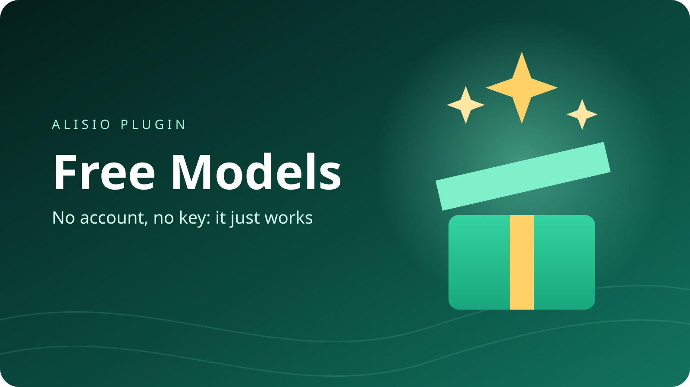

# @alisio/plugin-free-models



> English: [README.md](./README.md). Ambos README deben actualizarse en conjunto.

Modelos de IA gratis para Alisio casi sin configuración. Instálalo y ya funciona: **Kilo Code**
viene seleccionado con el modelo `kilo-auto/free` y no necesita cuenta ni clave. Si quieres,
puedes cambiar a otro proveedor gratuito de una lista. Solo se muestran modelos gratis.

## Instalación

```bash
alisio install npm:@alisio/plugin-free-models
```

Después abre las conexiones de Alisio (`/connect`) y añade **Free Models**. Deja todo como está y
guarda: Kilo Code con `kilo-auto/free` ya está listo para conversar.

## Cambiar de proveedor

En la conexión Free Models, la lista **Provider** muestra cada proveedor con una pista corta: "no
key needed" (no necesita clave) o "needs a free key" (necesita una clave gratuita), además de sus
límites gratuitos. Elige uno y guarda. La lista de modelos muestra entonces solo los modelos
gratis de ese proveedor, cada uno con sus límites gratuitos en el nombre.

- **No necesitan clave:** Kilo Code, LLM7.io y OVHcloud AI Endpoints. Siempre se usan de forma
  anónima; el campo Key se ignora para ellos.
- **Necesitan una clave gratuita:** todos los demás. Pega la clave en el campo **Key**. Si falta,
  Alisio muestra los pasos y el enlace para obtenerla.

Consejo: crea una conexión por proveedor (por ejemplo "Free Models - Groq") para que cada una
guarde su propia clave. Una clave que claramente pertenece a otro proveedor se rechaza y nunca se
envía.

Escribe `/free-models:help es` para ver cada proveedor, sus límites gratuitos y cómo obtener una
clave (`/free-models:help groq es` para un solo proveedor). En Alisio 0.11.5 o posterior, la
página **Modelos gratis** del espacio de trabajo muestra la misma guía, con una ventana de pasos
para cada clave.

## Límites gratuitos

| Proveedor | Clave | Límites gratuitos | Notas |
| --- | --- | --- | --- |
| Kilo Code | No hace falta | 200 peticiones por hora (por dirección IP) | no necesita cuenta ni clave; kilo-auto/free elige un modelo gratis en cada petición; los proveedores gratuitos pueden registrar tus mensajes; se usa de forma anónima; el campo de clave se ignora |
| LLM7.io | No hace falta | sin límites publicados | no necesita cuenta ni clave; el proveedor no publica los límites gratuitos exactos; los proveedores gratuitos pueden registrar tus mensajes; se usa de forma anónima; el campo de clave se ignora |
| OVHcloud AI Endpoints | No hace falta | 2 peticiones por minuto (por dirección IP y por modelo) | no necesita cuenta ni clave; alojado en la Unión Europea; se usa de forma anónima; el campo de clave se ignora |
| OpenRouter | Clave gratuita | 20 peticiones por minuto, 50 peticiones por día (compartido entre todos los modelos gratis) | no necesita tarjeta de crédito; los proveedores gratuitos pueden registrar tus mensajes |
| Groq | Clave gratuita | 30 peticiones por minuto, 1.000 peticiones por día (por modelo) | no necesita tarjeta de crédito |
| Google Gemini | Clave gratuita | sin límites publicados | no necesita tarjeta de crédito; el proveedor no publica los límites gratuitos exactos; los mensajes del plan gratuito pueden usarse para mejorar o entrenar modelos |
| Mistral AI | Clave gratuita | aproximadamente 1 petición por segundo, 500.000 tokens por minuto (por cuenta) | no necesita tarjeta de crédito; los mensajes del plan gratuito pueden usarse para mejorar o entrenar modelos |
| Cohere | Clave gratuita | 20 peticiones por minuto, 1.000 peticiones por mes (por cuenta) | no necesita tarjeta de crédito; solo para uso no comercial |
| NVIDIA NIM | Clave gratuita | 40 peticiones por minuto, 10.000 peticiones por día (por modelo) | requiere la membresía gratuita del NVIDIA Developer Program |
| Z AI | Clave gratuita | 1 petición simultánea (por cuenta) | no necesita tarjeta de crédito |
| Aion Labs | Clave gratuita | 15 peticiones por minuto, 20.000 tokens por día (por cuenta) | no necesita tarjeta de crédito; especializado en rol y narrativa |
| Gonka Broker | Clave gratuita | aproximadamente 1.000.000 tokens por mes (compartido entre todos los modelos gratis) | no necesita tarjeta de crédito; el registro requiere verificar un teléfono |

Los planes gratuitos cambian a menudo. El plugin lee la lista de modelos en vivo cuando el
proveedor indica cuáles son gratis (Kilo Code, OpenRouter, LLM7.io) o los nombra con claridad
(Google Gemini, Mistral AI, Cohere, Z AI), y usa una lista integrada si eso falla.

## Cómo obtener una clave gratuita

### OpenRouter

1. Abre https://openrouter.ai/keys e inicia sesión con Google, GitHub o correo.
2. Pulsa "Create API Key", ponle cualquier nombre y confirma.
3. Copia la clave ahora: solo se muestra una vez.
4. Pégala en el campo Clave de la conexión.

### Groq

1. Abre https://console.groq.com/keys e inicia sesión con Google, GitHub o correo.
2. Pulsa "Create API Key" y ponle cualquier nombre.
3. Copia la clave ahora: solo se muestra una vez.
4. Pégala en el campo Clave de la conexión.

### Google Gemini

1. Abre https://aistudio.google.com/app/apikey e inicia sesión con tu cuenta de Google.
2. Pulsa "Create API key" y elige o crea un proyecto.
3. Copia la clave.
4. Pégala en el campo Clave de la conexión.

### Mistral AI

1. Abre https://console.mistral.ai/api-keys y crea una cuenta o inicia sesión.
2. Elige el plan gratuito si te lo pide; puede que tengas que verificar un teléfono.
3. Pulsa "Create new key" y cópiala: solo se muestra una vez.
4. Pégala en el campo Clave de la conexión.

### Cohere

1. Abre https://dashboard.cohere.com/api-keys y crea una cuenta o inicia sesión.
2. Ya aparece una clave gratuita "Trial"; también puedes crear otra.
3. Copia la clave de prueba.
4. Pégala en el campo Clave de la conexión.

### NVIDIA NIM

1. Abre https://build.nvidia.com/explore/discover e inicia sesión o crea una cuenta gratuita de NVIDIA (te une al Developer Program gratuito).
2. Abre cualquier modelo y pulsa "Get API Key" y luego "Generate Key".
3. Copia la clave: empieza por nvapi-.
4. Pégala en el campo Clave de la conexión.

### Z AI

1. Abre https://z.ai/manage-apikey/apikey-list y crea una cuenta o inicia sesión.
2. Pulsa "Create a new API key" y ponle cualquier nombre.
3. Copia la clave.
4. Pégala en el campo Clave de la conexión.

### Aion Labs

1. Abre https://www.aionlabs.ai/app/api-keys/ y crea una cuenta o inicia sesión.
2. Crea una clave nueva.
3. Copia la clave.
4. Pégala en el campo Clave de la conexión.

### Gonka Broker

1. Abre https://app.gonkabroker.com/signup y crea una cuenta.
2. Verifica un número de móvil real por SMS (no se aceptan números de internet); los tokens gratis llegan después.
3. Crea una clave en el panel y cópiala.
4. Pégala en el campo Clave de la conexión.

## Privacidad

Los servicios gratuitos pueden registrar tus mensajes y algunos los usan para mejorar o entrenar
sus modelos (consulta las notas de arriba). No envíes datos personales ni confidenciales a través
de un modelo gratuito.

## No incluidos

Cloudflare Workers AI (necesita un identificador de cuenta en la dirección), ModelScope y
SiliconFlow (requieren verificación de identidad de China continental) quedan fuera a propósito.

## Licencia

MIT.
