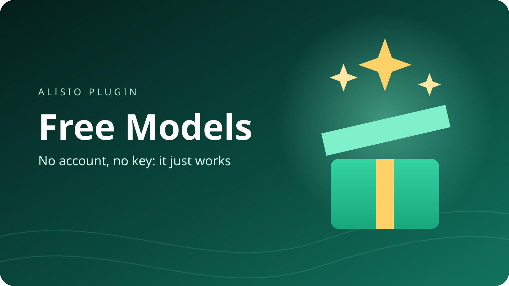

# @alisio/plugin-free-models



> Español: [README.es.md](./README.es.md). The two READMEs must be updated together.

Free AI models for Alisio with almost no setup. Install it and it already works: **Kilo Code** is
selected by default with the `kilo-auto/free` model, and it needs no account and no key. If you
want, you can switch to another free provider from a list. Only free models are shown.

## Install

```bash
alisio install npm:@alisio/plugin-free-models
```

Then open Alisio's connections (`/connect`) and add **Free Models**. Leave everything as it is and
save: Kilo Code with `kilo-auto/free` is ready to chat.

## Switch provider

In the Free Models connection, the **Provider** list shows every provider with a short hint: "no
key needed" or "needs a free key", plus its free limits. Pick one and save. The model list then
shows only that provider's free models, each with its free limits in its name.

- **No key needed:** Kilo Code, LLM7.io and OVHcloud AI Endpoints. They are always used
  anonymously; the Key field is ignored for them.
- **Needs a free key:** every other provider. Paste the key in the **Key** field. If it is missing,
  Alisio shows the steps and the link to get it.

Tip: create one connection per provider (for example "Free Models - Groq") so each one keeps its
own key. A key that clearly belongs to another provider is rejected and never sent.

Type `/free-models:help` to see every provider, its free limits and how to get a key
(`/free-models:help groq` for one provider, add `es` for Spanish). On Alisio 0.11.5 or newer, the
**Free models** page in the workspace shows the same guide, with a window of steps for each key.

## Free limits

| Provider | Key | Free limits | Notes |
| --- | --- | --- | --- |
| Kilo Code | Not needed | 200 requests per hour (per IP address) | no account or key needed; kilo-auto/free picks a free model for each request; free providers may log your prompts; used anonymously; the key field is ignored |
| LLM7.io | Not needed | no published limits | no account or key needed; the provider does not publish exact free limits; free providers may log your prompts; used anonymously; the key field is ignored |
| OVHcloud AI Endpoints | Not needed | 2 requests per minute (per IP address and per model) | no account or key needed; hosted in the European Union; used anonymously; the key field is ignored |
| OpenRouter | Free key | 20 requests per minute, 50 requests per day (shared across all free models) | no credit card needed; free providers may log your prompts |
| Groq | Free key | 30 requests per minute, 1,000 requests per day (per model) | no credit card needed |
| Google Gemini | Free key | no published limits | no credit card needed; the provider does not publish exact free limits; free-tier prompts may be used to improve or train models |
| Mistral AI | Free key | about 1 request per second, 500,000 tokens per minute (per account) | no credit card needed; free-tier prompts may be used to improve or train models |
| Cohere | Free key | 20 requests per minute, 1,000 requests per month (per account) | no credit card needed; non-commercial use only |
| NVIDIA NIM | Free key | 40 requests per minute, 10,000 requests per day (per model) | needs a free NVIDIA Developer Program membership |
| Z AI | Free key | 1 concurrent request (per account) | no credit card needed |
| Aion Labs | Free key | 15 requests per minute, 20,000 tokens per day (per account) | no credit card needed; specialized in roleplay and storytelling |
| Gonka Broker | Free key | about 1,000,000 tokens per month (shared across all free models) | no credit card needed; sign-up needs phone verification |

Free tiers change often. The plugin reads the live model list where the provider says which
models are free (Kilo Code, OpenRouter, LLM7.io) or names them clearly (Google Gemini, Mistral AI,
Cohere, Z AI), and falls back to a built-in list if that fails.

## How to get a free key

### OpenRouter

1. Open https://openrouter.ai/keys and sign in with Google, GitHub or email.
2. Click "Create API Key", give it any name and confirm.
3. Copy the key now: it is shown only once.
4. Paste it in the Key field of the connection.

### Groq

1. Open https://console.groq.com/keys and sign in with Google, GitHub or email.
2. Click "Create API Key" and give it any name.
3. Copy the key now: it is shown only once.
4. Paste it in the Key field of the connection.

### Google Gemini

1. Open https://aistudio.google.com/app/apikey and sign in with your Google account.
2. Click "Create API key" and pick or create a project.
3. Copy the key.
4. Paste it in the Key field of the connection.

### Mistral AI

1. Open https://console.mistral.ai/api-keys and create an account or sign in.
2. Choose the free plan if asked; you may need to verify a phone number.
3. Click "Create new key" and copy it: it is shown only once.
4. Paste it in the Key field of the connection.

### Cohere

1. Open https://dashboard.cohere.com/api-keys and create an account or sign in.
2. A free "Trial" key is already listed; you can also create a new trial key.
3. Copy the trial key.
4. Paste it in the Key field of the connection.

### NVIDIA NIM

1. Open https://build.nvidia.com/explore/discover and sign in or create a free NVIDIA account (it joins the free Developer Program).
2. Open any model and click "Get API Key", then "Generate Key".
3. Copy the key: it starts with nvapi-.
4. Paste it in the Key field of the connection.

### Z AI

1. Open https://z.ai/manage-apikey/apikey-list and create an account or sign in.
2. Click "Create a new API key" and give it any name.
3. Copy the key.
4. Paste it in the Key field of the connection.

### Aion Labs

1. Open https://www.aionlabs.ai/app/api-keys/ and create an account or sign in.
2. Create a new key.
3. Copy the key.
4. Paste it in the Key field of the connection.

### Gonka Broker

1. Open https://app.gonkabroker.com/signup and create an account.
2. Verify a real mobile phone number by text message (internet phone numbers are not accepted); the free tokens arrive after this.
3. Create a key in the dashboard and copy it.
4. Paste it in the Key field of the connection.

## Privacy

Free services may log your prompts, and some use them to improve or train their models (see the
notes above). Do not send personal or confidential data through a free model.

## Not included

Cloudflare Workers AI (needs an account ID in the address), ModelScope and SiliconFlow (need
mainland-China identity verification) are left out on purpose.

## License

MIT.
