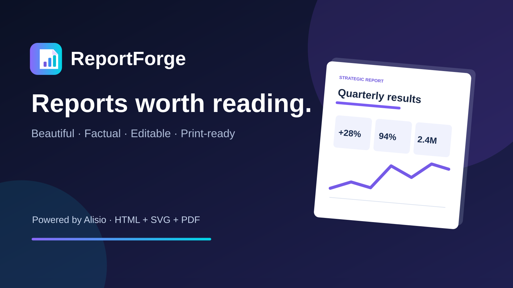
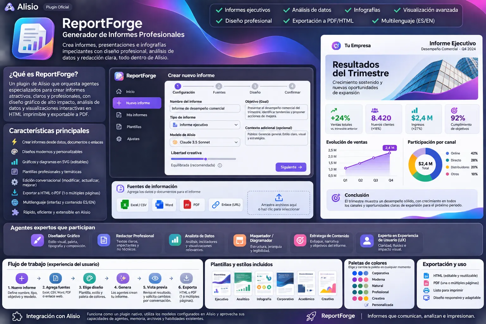

# ReportForge para Alisio

[English](./README.md). Ambos README deben actualizarse juntos.



ReportForge convierte sus datos, documentos y páginas web en **informes e infografías de calidad
editorial**: resúmenes ejecutivos, tarjetas de indicadores, gráficos, tablas y líneas de tiempo,
redactados por el modelo de Alisio que usted elija y maquetados listos para imprimir. Está pensado
para quienes necesitan comunicar datos con claridad sin conocimientos de maquetación ni diseño:
gerentes, analistas, consultores, docentes e investigadores.



*Concepto de diseño. Algunos elementos que muestra, como las pantallas de plantillas y de ajustes,
no forman parte de la versión 0.1.0.*

## Requisitos

- Alisio **0.11.6 o posterior dentro de 0.11.x** (el estudio es una aplicación de plugin con
  solicitudes de aprobación). En versiones anteriores solo funcionan la herramienta de lectura
  `reportforge_reports` y el comando de ayuda.
- Un proveedor de modelos conectado (`/connect`). ReportForge no solicita credenciales propias.
- Para **↓ PDF**: un navegador de la familia Chromium instalado en el equipo donde se ejecuta Alisio
  (Google Chrome, Chromium, Microsoft Edge, Brave, Vivaldi u Opera; no se descarga nada), y una
  sesión que permita ejecutar programas. Defina `ALISIO_REPORTFORGE_CHROME` con el ejecutable del
  navegador si está instalado en una ubicación poco habitual.

## Instalación

```bash
alisio install npm:@alisio/plugin-reportforge
```

Después abra **Generador de informes** (ReportForge) desde el grupo **Aplicaciones** de su proyecto.

## Uso del estudio

1. **Nuevo informe**: indique el nombre, el tipo (ejecutivo, financiero, técnico, marketing,
   operaciones, investigación, infografía o personalizado), el idioma del informe (español o
   inglés, independiente del idioma de Alisio), el modelo, la libertad creativa, el objetivo, el
   contexto y el público. Elija una de las seis paletas.
2. **Agregue fuentes**: archivos CSV, Excel (XLSX), Word (DOCX), PDF con texto, TXT, Markdown, JSON
   o HTML de hasta 8 MB cada uno, y páginas web HTTPS públicas. Hasta 30 fuentes por informe.
   Elimine una fuente con **Quitar**.
3. **Generar informe**: el modelo redacta el informe como bloques estructurados mientras usted
   espera; puede **Cancelar**. Diez tipos de bloque: texto destacado, párrafo, cita, indicador,
   gráficos de barras, líneas y anillo, tabla, línea de tiempo y llamada de atención. Si la respuesta
   no se puede usar (incompleta, ilegible o sin suficientes bloques válidos), ReportForge pide al
   modelo una vez más un informe compacto; los bloques no válidos se omiten y el estudio indica
   cuántos. Cuando la generación falla, el mensaje explica el motivo.
4. **Ajuste**: pida un cambio con sus palabras (**Pide una modificación**) o edite un gráfico
   directamente: columnas que ocupa, altura y datos (etiquetas y valores). La paleta, las columnas
   (de 1 a 3), el tamaño de página (A4 o Carta) y el diseño cambian al instante sin llamar al modelo.
   **Modelo para la próxima generación** cambia el modelo del informe (o elige el Modelo
   predeterminado de Alisio); si el modelo guardado ya no está disponible, el estudio lo indica y
   usa el predeterminado.
5. **Exportación**: **↓ PDF** crea el PDF con su navegador local (sin ventana, sin conexión y con un
   perfil temporal) y lo descarga con el título del informe como nombre; puede **Cancelar**.
   **↓ HTML** descarga un único archivo HTML autocontenido.
6. **Borrado**: **Borrar informe** (en el informe abierto o en la lista) pide confirmación, detiene
   una generación en curso y elimina el informe con sus fuentes.

El estudio sigue el idioma de Alisio (español o inglés).

## Resultados

- **HTML autocontenido**: un solo archivo con CSS y gráficos SVG integrados, sin JavaScript ni
  fuentes o recursos remotos. Se abre sin conexión en cualquier navegador.
- **Varias páginas**: se imprime con márgenes, sin gráficos ni indicadores partidos entre páginas y
  sin títulos aislados al pie de una página.
- **Ajustar a una página**: el estudio mide el informe al ancho imprimible de la hoja elegida y
  calcula el único factor de escala que lo hace caber en una página. El texto y los gráficos siguen
  siendo vectoriales (nítidos a cualquier escala) y no se recorta nada. Por debajo de
  aproximadamente el 55 % el estudio advierte que el texto será pequeño, y por debajo del 20 %
  recomienda usar varias páginas. El ajuste se guarda con el informe, por lo que el HTML descargado
  se imprime igual.

- **PDF**: el mismo HTML impreso por el navegador local con sus fondos, el tamaño de página del
  informe (A4 o Carta) y sus márgenes. En los informes de una página, el navegador que imprime
  vuelve a comprobar la escala guardada y la reduce un poco si la página fuera a pasar a una segunda
  hoja.

Si no se encuentra un navegador, o la sesión no permite ejecutar programas, el estudio lo indica:
use **↓ HTML**, abra el archivo en su navegador y guárdelo como PDF desde allí.

## Seguridad

- Por diseño, los informes no inventan cifras: se indica al modelo que use solo sus fuentes y que
  declare lo que estas no cubren, y cada bloque que devuelve se valida (tipos, tamaños, números
  finitos) antes de llegar al informe. Se ejecuta en una sesión secundaria de solo lectura, sin
  herramientas ni permisos de escritura o de procesos. El texto de las fuentes se trata como datos,
  nunca como instrucciones.
- Todo lo que se muestra en un informe se escapa; el HTML exportado no contiene scripts.
- **↓ PDF** es la única acción que ejecuta un programa (el permiso de *procesos* de la sesión): el
  navegador local se inicia sin ventana con un perfil temporal que se elimina al terminar, el informe
  se inyecta sin archivo ni URL, los nombres de host no se resuelven, la red queda sin conexión y se
  bloquea toda solicitud salvo el contenido `data:` integrado. Cancelar o un límite de dos minutos lo
  detienen.
- Páginas web: solo direcciones HTTPS públicas en el puerto 443. Cada respuesta DNS debe ser una
  dirección pública (se rechazan rangos privados, de bucle local, de enlace local, de metadatos en
  la nube y rangos IPv6 especiales), la conexión se fija a la dirección comprobada, cada
  redirección se vuelve a comprobar y las páginas se limitan a HTML, 2 MB y 12 segundos.
- Los archivos de Office se leen sin ejecutar macros ni extraer contenido incrustado; el texto de
  los PDF se lee con PDF.js sin fuentes ni WebAssembly.

## Datos

Los informes se guardan en el estado privado del plugin en Alisio, una carpeta por espacio de
trabajo y un archivo JSON por informe (escrito de forma atómica). El HTML generado siempre se
reconstruye a partir de ese documento y nunca se almacena.

## Limitaciones

- Los PDF escaneados requieren OCR, que no se incluye; las imágenes dentro de los documentos se
  ignoran.
- La generación solicita hasta 32 768 tokens de salida (menos si el catálogo del modelo admite
  menos) y un informe de 12 componentes como máximo; los modelos con límites de salida muy pequeños
  pueden producir informes más breves.
- El estudio se ha probado con un host simulado y con pruebas unitarias. **↓ PDF** requiere un
  navegador de la familia Chromium en el equipo donde se ejecuta Alisio y una sesión que permita
  ejecutar programas; se rechazan los PDF de más de 40 MB (use la descarga HTML, como se indica
  arriba).

## Recursos

Agente `rf-editor`, habilidad `rf-design` (reglas de diseño editorial), herramienta de lectura
`reportforge_reports`, comando `help` y la aplicación **ReportForge**.

## Desarrollo

```sh
pnpm --filter @alisio/plugin-reportforge test
pnpm --filter @alisio/plugin-reportforge build
```

Las pruebas usan un modelo simulado, un host simulado y un servidor HTTP local; nunca llaman a un
modelo real ni a internet.

## Licencia

MIT. PDF.js (`pdfjs-dist`) tiene licencia Apache-2.0 y `fflate`, MIT.
