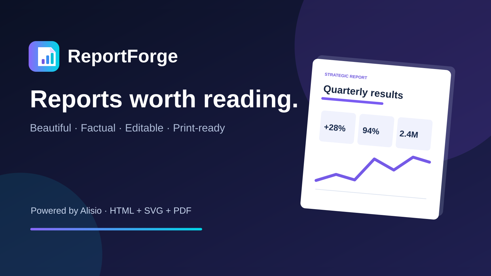
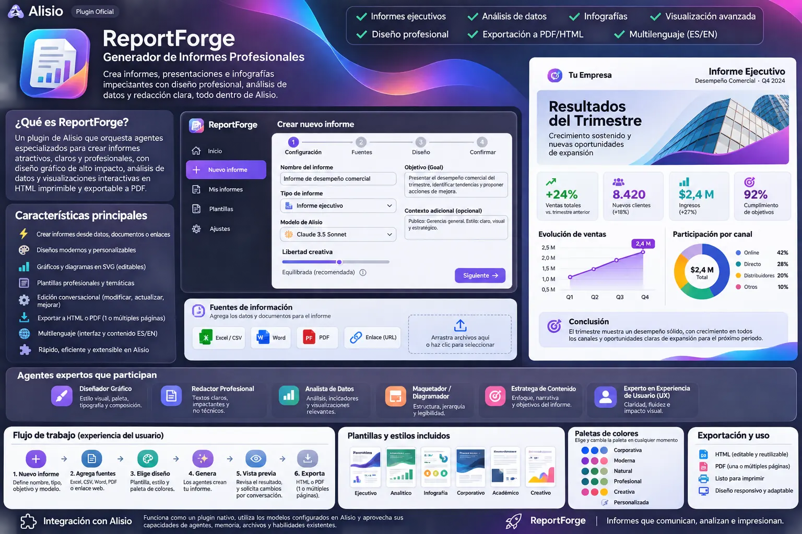

# ReportForge for Alisio

[Español](./README.es.md). Both READMEs must be updated together.



ReportForge turns your data, documents and web pages into **editorial-quality reports and
infographics**: executive summaries, KPI cards, charts, tables and timelines, written by the Alisio
model you choose and laid out ready to print. It is made for people who need to communicate data
clearly without layout or design skills: managers, analysts, consultants, teachers and researchers.



*Design concept (in Spanish). Some elements it shows, such as templates and settings screens, are
not part of 0.1.0.*

## Requirements

- Alisio **0.11.6 or newer within 0.11.x** (the studio is a plugin app with approval prompts). On
  older hosts only the read-only tool `reportforge_reports` and the help command work.
- A connected model provider (`/connect`). ReportForge asks for no credentials of its own.

## Install

```bash
alisio install npm:@alisio/plugin-reportforge
```

Then open **ReportForge** from your project's **Apps** group.

## Use the studio

1. **New report**: give it a name, type (executive, financial, technical, marketing, operations,
   research, infographic or custom), report language (English or Spanish, independent of Alisio's
   language), model, creative freedom, goal, context and audience. Pick one of six palettes.
2. **Add sources**: CSV, Excel (XLSX), Word (DOCX), PDF with text, TXT, Markdown, JSON or HTML files
   up to 8 MB each, and public HTTPS web pages. Up to 30 sources per report. Remove a source with
   **Remove**.
3. **Generate report**: the model writes the report as structured blocks while you wait; you can
   **Cancel**. Ten block types: lead, paragraph, quote, KPI, bar, line and donut charts, table,
   timeline and callout.
4. **Refine**: ask for a change in plain words (**Request a change**), or edit a chart directly:
   columns it spans, height and its data (labels and values). Palette, columns (1 to 3), page size
   (A4 or Letter) and layout change instantly without calling the model.
5. **Export**: **PDF / Print** opens the print dialog for the preview (choose *Save as PDF*);
   **↓ HTML** downloads a single self-contained HTML file.

The studio follows Alisio's language (English or Spanish).

## Output

- **Self-contained HTML**: one file with inline CSS and SVG charts, no JavaScript, no remote fonts
  or resources. It opens offline in any browser.
- **Multiple pages**: printed with page margins, no charts or KPI cards split across pages, and no
  headings left at the bottom of a page.
- **Fit to one page**: the studio measures the report at the printable width of the chosen sheet and
  computes the one zoom factor that fits it on a single page. Text and charts stay vector (sharp at
  any zoom); nothing is clipped. Below about 55% the studio warns that the text will be small, and
  past 20% it recommends multiple pages. The fit is stored with the report, so the downloaded HTML
  prints the same way.

If your Alisio window does not open a print dialog, download the HTML, open it in your browser and
print it from there (*Save as PDF*).

## Safety

- Reports never invent figures by design: the model is told to use only your sources and to state
  what they do not cover, and every block it returns is checked (types, sizes, finite numbers)
  before it reaches the report. It runs in a read-only child session with no tools and no write or
  process permission. Text inside your sources is treated as data, never as instructions.
- Everything shown in a report is escaped; exported HTML contains no scripts.
- Web pages: only public HTTPS addresses on port 443. Every DNS answer must be a public address
  (private, loopback, link-local, cloud metadata and special IPv6 ranges are refused), the
  connection is pinned to the checked address, every redirect is checked again, and pages are
  limited to HTML, 2 MB and 12 seconds.
- Office files are read without running macros or unpacking embedded media; PDF text is read with
  PDF.js without fonts or WebAssembly.

## Data

Reports live in Alisio's private plugin state, one folder per workspace, one JSON file per report
(written atomically). Generated HTML is always rebuilt from that document, never stored.

## Limitations

- Scanned PDFs need OCR, which is not included; images inside documents are ignored.
- Generation needs a model that can return about 12,000 output tokens in one answer.
- The studio has been tested against a simulated host and in unit tests; printing depends on the
  host window allowing the print dialog (otherwise use the HTML download, as above).

## Resources

Agent `rf-editor`, skill `rf-design` (editorial design rules), read-only tool
`reportforge_reports`, command `help`, and the **ReportForge** app.

## Development

```sh
pnpm --filter @alisio/plugin-reportforge test
pnpm --filter @alisio/plugin-reportforge build
```

Tests use a fake model, a fake host and a local HTTP server; they never call a real model or the
internet.

## License

MIT. PDF.js (`pdfjs-dist`) is Apache-2.0 and `fflate` is MIT.
