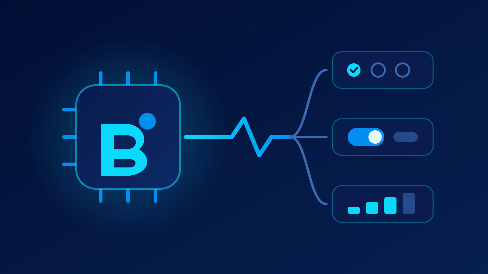

<PluginDetail slug="bekko" />

[English](https://github.com/GustavoGutierrez/alisio-plugins/blob/HEAD/packages/plugin-bekko/README.md). Ambos README deben actualizarse juntos.



Proveedor local de decisiones "System One" para [Alisio](https://github.com/GustavoGutierrez/alisio).
Las funciones que piden a Alisio una decisión `select`, `boolean` u `ordinal` reciben una respuesta
rápida de **Bekko**, un modelo pequeño de decisiones tipadas que se ejecuta en la CPU: sin llamada
a un LLM, sin Python, sin GPU y sin que los datos salgan del equipo una vez descargado el modelo.

Es un plugin independiente, sin relación con el proyecto Bekko. **Bekko es opcional: Alisio
funciona sin él**, y cada función conserva su propio comportamiento alternativo cuando ningún
proveedor responde.

## Requisitos

- Alisio con la API de decisiones (`>=0.9.0 <0.12.0`); en versiones anteriores solo se cargan los
  comandos.
- Disco: unos **200 MB** para el modelo predeterminado `68m` (unos 33 MB para `17m`), más las
  dependencias de npm (ONNX Runtime y Transformers.js, unos 450 MB instalados).
- Memoria: el proceso de Alisio llegó a unos 1,6 GB con el modelo `68m` cargado (medido en Linux x64); conviene disponer de esa memoria libre.
- Red solo para la primera descarga, desde Hugging Face.

## Instalación y activación

```bash
alisio install npm:@alisio/plugin-bekko
```

Después, dentro de Alisio:

1. `/bekko:activate` pide a Alisio que convierta a Bekko en el proveedor de decisiones activo.
   Alisio solicita confirmación y guarda `decisions.provider` por sí mismo; nunca sustituye otro
   proveedor ya configurado. Si el host no ofrece esa capacidad, configure
   `decisions.provider = "bekko"` manualmente.
2. Una vez activo, el modelo se descarga y se carga en segundo plano. Mientras no esté listo,
   Alisio sigue usando su comportamiento alternativo habitual. `/bekko:status` muestra el progreso.
3. Opcional: `/bekko:setup` descarga y carga el modelo de inmediato, sin cambiar el proveedor activo.

Instalar el paquete por sí solo no descarga ni inicia nada.

## Comandos

| Comando | Qué hace |
| --- | --- |
| `/bekko:status` | Estado del modelo (`inactive`, `loading`, `ready`, `failed`) con su detalle, y el proveedor de decisiones activo. |
| `/bekko:setup` | Descarga (la primera vez) y carga el modelo de inmediato; indica el tamaño de la descarga. |
| `/bekko:activate` | Pide a Alisio que active Bekko como proveedor de decisiones (Alisio solicita confirmación). |

## Funcionamiento

- Cada solicitud (`DecisionRequest` v1: hasta 16 decisiones, 32 KiB) se traduce a las preguntas
  tipadas de Bekko: `select` a una elección entre 2 y 20 opciones, `boolean` a una pregunta sí/no
  y `ordinal` a una puntuación entre 2 y 10 niveles.
- El modelo se ejecuta con ONNX Runtime Web sobre WebAssembly (CPU) mediante
  [`jev-web`](https://github.com/warsang/jev-web). Cargar el modelo `68m` tomó unos 7 segundos la
  primera vez y 2,5 segundos desde la copia local en una CPU de escritorio; una solicitud de tres
  decisiones respondió en alrededor de una décima de segundo.
- El proveedor nunca espera al modelo: mientras se carga, la solicitud falla de inmediato como "no
  listo" y Alisio usa su alternativa. Se rechazan las respuestas con probabilidades no válidas o
  cuya entrada el modelo tuvo que truncar, en lugar de adivinar.
- `confidence` es la probabilidad que el propio modelo asigna a su respuesta. No está calibrada, por
  lo que conviene mantener el umbral `decisions.minConfidence` de Alisio.

## Descarga e integridad del modelo

- Los archivos provienen únicamente de revisiones fijas de `hotchpotch/bekko-system-one-v0-68m` (o
  `-v0-17m`) en Hugging Face: `manifest.json`, `tokenizer.json` y `model.onnx`.
- Cada archivo se comprueba contra un tamaño y un resumen SHA-256 incluidos en esta versión del
  plugin antes de usarse, y solo se guarda en caché si la comprobación es correcta. Las
  redirecciones solo se siguen dentro de los dominios de Hugging Face (`huggingface.co`, `hf.co`).
- La caché se guarda en el directorio de caché del plugin que proporciona Alisio (o en
  `ALISIO_BEKKO_CACHE_DIR`, o en `~/.alisio/cache/bekko`). Un archivo dañado se detecta y se
  descarga de nuevo. Elimine el directorio para liberar espacio.

## Limitaciones

- **Licencia del modelo.** La ficha del modelo Bekko indica que la licencia de los pesos publicados
  "está pendiente de definirse" y no asigna ninguna. Este plugin no incluye los pesos; los descarga
  de Hugging Face al activarse. Revise la ficha del modelo antes de usar Bekko en un producto.
- Bekko v0 está entrenado principalmente en inglés. Las decisiones en otros idiomas funcionan, pero
  son menos fiables.
- La inferencia se ejecuta en el hilo principal del proceso de Alisio. Una solicitud que supera su
  plazo se informa como tiempo agotado, pero el cálculo ONNX ya iniciado termina en segundo plano.
- No se ofrece la variante de 400M (descarga de 1,4 GB).

## Uso avanzado

```ts
import { createBekkoPlugin } from "@alisio/plugin-bekko";

export default createBekkoPlugin({ variant: "17m" }); // más pequeño, menor calidad
```

`createBekkoPlugin` también acepta `cacheDir` y un `engineFactory` (para pruebas o un runtime propio).

## Desarrollo

```sh
pnpm --filter @alisio/plugin-bekko test
pnpm --filter @alisio/plugin-bekko build
```

Las pruebas unitarias usan un motor y una red simulados; nunca descargan el modelo.

## Fuentes

- Bekko System One: <https://github.com/hotchpotch/bekko-system-one> (código de runtime MIT) y
  <https://huggingface.co/hotchpotch/bekko-system-one-v0-68m>.
- `jev-web` (MIT), ONNX Runtime Web (MIT), Transformers.js (Apache-2.0).

## Licencia

MIT para este plugin. Los pesos del modelo Bekko no forman parte de este paquete y tienen sus
propias condiciones (consulte Limitaciones).
