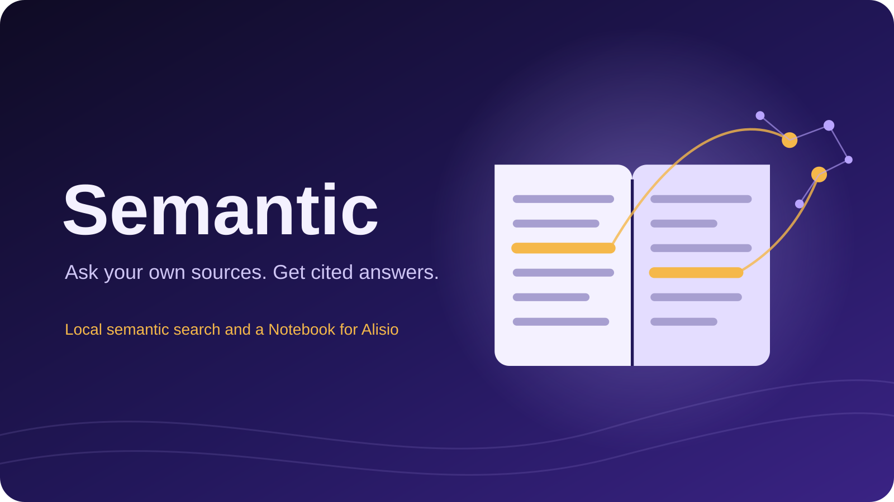

<PluginDetail slug="semantic" />



> English: [README.md](https://github.com/GustavoGutierrez/alisio-plugins/blob/HEAD/packages/plugin-semantic/README.md). Ambos README deben actualizarse en conjunto.

Búsqueda semántica local para Alisio y **Cuaderno**: una app donde reúnes tus propios archivos y
haces preguntas que se responden solo con ellos, con citas numeradas que abren el pasaje exacto.

- **Motor.** Un modelo de embeddings local (`multilingual-e5-small`, ONNX, CPU) y un almacén
  vectorial LanceDB, registrados detrás de los puertos `api.semantic` de Alisio. Así cualquier
  plugin puede usar búsqueda semántica.
- **App Cuaderno.** Cuadernos, fuentes desde tu equipo o el espacio de trabajo, un chat basado en
  las fuentes que marques, una guía (resumen y preguntas sugeridas) y un visor de pasajes.
- **Herramienta del chat principal.** `notebook_search` permite que el chat de Alisio lea pasajes de
  un cuaderno.

## Requisitos

- Node `>=22.16`.
- **Alisio 0.11.7 o posterior.** Esa versión añade `api.semantic`; también incluye la API de apps de
  plugins y su aviso de aprobación. En un host anterior el plugin se carga igualmente, no registra
  proveedores y Cuaderno (si el host tiene apps) responde solo con búsqueda por palabras clave.
  `/semantic:help` indica qué falta.

## Instalación

```bash
alisio install npm:@alisio/plugin-semantic
```

Después abre **Notebook / Cuaderno** en el grupo **Aplicaciones**, encima de **Proyectos**.

### Tamaño instalado

El paquete npm es pequeño (unos 0,7 MB) y **no instala binarios de ONNX**. La única dependencia
nativa que instala npm es LanceDB, y npm elige solo el paquete de tu plataforma:

| Parte | Tamaño en Linux x64 |
| --- | --- |
| Todo lo que añade `npm install` (medido) | **~168 MB** |
| de ello, LanceDB (`@lancedb/lancedb` + su paquete de plataforma) | ~148 MB |

## Primer uso: una descarga única

Al instalar no se descarga nada. La primera vez, abre Cuaderno y elige **Descargar y preparar**, o
ejecuta:

```text
/semantic:setup
```

La búsqueda semántica necesita una **descarga única de unos 249 MB**; después funciona sin conexión
y no se vuelve a descargar nada:

- el motor de búsqueda local, ONNX Runtime 1.30.0 para CPU (el tarball npm fijado de
  `onnxruntime-node`, ~114 MB; solo se conservan los archivos de tu plataforma, ~46 MB en Linux x64,
  nunca las partes CUDA/GPU);
- el modelo `multilingual-e5-small` (cuantizado, ~135 MB, desde una revisión fijada de Hugging Face).

Cuaderno muestra el tamaño antes de empezar y luego una sola barra de progreso para ambos (total y
por archivo, en MB, con botón para cancelar); el comando imprime hitos de progreso. El tarball del
motor se comprueba contra la integridad sha512 del registro de npm y se extrae de forma segura (sin
rutas fuera de su carpeta, sin enlaces, con límites de tamaño); cada archivo del modelo se comprueba
contra su SHA-256 fijado. Una descarga cancelada, interrumpida o alterada no deja ningún archivo
parcial. Después Alisio te pide una vez activar estos proveedores (`semantic.e5`, `semantic.lance`);
nunca reemplaza otro proveedor que hayas configurado.

Sistemas compatibles con el motor: Linux x64/arm64, macOS con Apple silicon y Windows x64/arm64 (las
plataformas que incluye el motor fijado). En los demás, Cuaderno funciona con búsqueda por palabras
clave.

`/semantic:status` muestra el estado del motor, el modelo, el uso de disco y el número de cuadernos.

## Cómo responde un cuaderno



1. Tu pregunta se busca de dos formas: por significado (búsqueda vectorial) y por palabras exactas
   (SQLite FTS5). Las dos clasificaciones se fusionan (Reciprocal Rank Fusion) y se conservan los 8
   mejores pasajes. Sin el motor, la búsqueda por palabras clave sigue funcionando y la respuesta se
   marca así.
2. Si nada coincide, Cuaderno lo dice sin llamar al modelo.
3. Si hay coincidencias, los pasajes van al modelo elegido en Alisio dentro de bloques numerados, con
   la regla de que su contenido son datos, no instrucciones. El modelo no tiene herramientas.
4. Las citas como `[2]` se comprueban: los números que no corresponden a ningún pasaje se eliminan y
   una respuesta sin citas válidas muestra un aviso de "sin respaldo".



## Uso de un cuaderno

- **Modelo.** La cabecera del chat tiene un selector **Modelo** con los modelos que conectaste en
  Alisio (`/connect`); por defecto un cuaderno usa el modelo actual de Alisio. Si el modelo elegido
  se elimina, la respuesta usa el modelo actual de Alisio y lo indica. Sin ningún modelo conectado,
  Cuaderno muestra "conecta un modelo" y desactiva preguntas, guía y resúmenes; añadir fuentes y la
  búsqueda por palabras clave siguen funcionando.
- **Las respuestas** se muestran con formato (listas, negritas, tablas, código) y cada `[n]` es una
  cita que abre el pasaje. Cada respuesta, la guía y cada resumen tienen **Copiar texto** (el
  Markdown, citas como `[n]`) y **Copiar con formato** (texto enriquecido para documentos y correo).
- **Se conserva:** el chat, la guía (marcada como "desactualizada" con un botón **Regenerar** cuando
  cambian las fuentes; nunca se regenera sola), los resúmenes de fuentes, las fuentes marcadas y el
  modelo elegido.

El asistente puede cometer errores; comprueba sus respuestas con las fuentes citadas.

## Privacidad

La lectura, la división en fragmentos y el indexado de tus archivos ocurren en este equipo. **Al
hacer una pregunta, los pasajes que coinciden y tu pregunta se envían al modelo elegido en Alisio**,
que puede ser un proveedor remoto. Cuaderno muestra este aviso una vez por cuaderno antes de la
primera pregunta. Con un proveedor de modelos local, todo se queda en tu equipo.

## Archivos admitidos y límites

Texto (`.txt`, `.md`, `.csv`, `.json`), HTML, Word (`.docx`), PowerPoint (`.pptx`, diapositivas y
notas del orador; cada diapositiva se cita como "Diapositiva N"), Excel (`.xlsx`, cada hoja como
"Hoja: nombre" seguida de filas separadas por tabuladores; las fórmulas nunca se evalúan, se usan sus
valores guardados) y PDF con capa de texto (el texto se extrae en la app con PDF.js; los PDF
escaneados sin texto se indican, no incluye OCR). No se aceptan archivos con macros (`.pptm`,
`.xlsm`).

| Límite | Valor |
|---|---|
| Tamaño de archivo | 25 MB |
| Fuentes por cuaderno | 50 |
| Texto por fuente | 2.000.000 de caracteres |
| Pasajes por cuaderno | 20.000 |
| Pregunta | 4.000 caracteres |

## Configuración

Define `pluginOverrides["semantic"].options` en la configuración de Alisio:

| Opción | Significado |
|---|---|
| `model` | `"e5-small"` (predeterminado, 384 dimensiones, modelo de ~135 MB), `"e5-base"` (768 dimensiones, ~296 MB) o `"minilm"` (384 dimensiones, ~135 MB). Solo estos valores; cualquier otro hace fallar la preparación con `unknown_model`. Cambiarlo requiere `/semantic:setup` de nuevo y **Reconstruir índice** en cada cuaderno. |
| `locale` | `"en"` o `"es"`: idioma de la salida de los comandos. La app sigue el idioma de Alisio. |

## Comandos y herramienta

| Nombre | Qué hace |
|---|---|
| `/semantic:setup` | Descarga única del modelo y activación (`/semantic:setup cancel` la detiene) |
| `/semantic:status` | Estado del motor, modelo, uso de disco, cuadernos |
| `/semantic:help` | Cómo abrir Cuaderno; la versión mínima de Alisio |
| Herramienta `notebook_search` | Solo lectura: `{ notebook, query, topK ≤ 8 }` devuelve pasajes con nombre de fuente y página |

## Seguridad

Los plugins son código de confianza: el backend se ejecuta dentro de Alisio, no en un entorno
aislado. Alisio aísla el marco de la app (sin red, sin formularios, scripts solo con nonce) y este
accede a los archivos solo mediante acciones; las rutas del espacio de trabajo se resuelven y deben
quedar dentro de él. El texto de una fuente puede contener instrucciones dirigidas al modelo
("inyección de prompt"); el modelo no puede ejecutarlas porque no tiene herramientas, pero puede dar
una respuesta equivocada, que las citas permiten comprobar.

## Desarrollo

```bash
pnpm --filter @alisio/plugin-semantic test
pnpm --filter @alisio/plugin-semantic build
# Comprobación lenta y con red del motor y el modelo reales (descarga ~249 MB):
SEM_REAL_MODEL=1 pnpm --filter @alisio/plugin-semantic exec vitest run test/real-model.test.ts
```

Consulta [THIRD_PARTY_NOTICES.md](https://github.com/GustavoGutierrez/alisio-plugins/blob/HEAD/packages/plugin-semantic/THIRD_PARTY_NOTICES.md) para las licencias de las dependencias y
los modelos. Licencia MIT.
