<PluginDetail slug="semantic" />


> Español: [README.es.md](https://github.com/GustavoGutierrez/alisio-plugins/blob/HEAD/packages/plugin-semantic/README.es.md). Both READMEs must be updated together.

Local semantic search for Alisio, plus **Notebook**: an app where you collect your own files and ask
questions that are answered only from them, with numbered citations that open the exact passage.

- **Engine.** A local embedding model (`multilingual-e5-small`, ONNX, CPU) and a LanceDB vector
  store, registered behind Alisio's `api.semantic` ports. Any plugin can then use semantic search.
- **Notebook app.** Notebooks, sources from your computer or the workspace, a chat grounded in the
  sources you tick, a guide (summary and suggested questions) and a passage viewer.
- **Main chat tool.** `notebook_search` lets the Alisio chat read passages from a notebook.

## Requirements

- Node `>=22.16`.
- **Alisio 0.11.7 or newer.** That release adds `api.semantic`; it also has the plugin apps API and
  its approval prompt. On an older host the plugin still loads, registers no provider, and the
  Notebook (when the host has apps) answers with keyword search only. `/semantic:help` says what is
  missing.

## Install

```bash
alisio install npm:@alisio/plugin-semantic
```

Then open **Notebook / Cuaderno** in the **Apps** group above **Projects**.

### Installed size

The npm package is small (about 0.7 MB) and installs **no ONNX binaries**. The only native
dependency installed by npm is LanceDB, and npm picks just your platform's package:

| Part | Size on Linux x64 |
| --- | --- |
| Everything `npm install` adds (measured) | **~168 MB** |
| of which LanceDB (`@lancedb/lancedb` + its platform package) | ~148 MB |

## First use: a one-time download

Nothing is downloaded at install time. The first time, open Notebook and choose **Download and
prepare**, or run:

```text
/semantic:setup
```

Semantic search needs a **one-time download of about 249 MB**, after which it works offline and
nothing is downloaded again:

- the local search engine, ONNX Runtime 1.30.0 for CPU (the pinned `onnxruntime-node` npm tarball,
  ~114 MB; only your platform's files, ~46 MB on Linux x64, are kept, never the CUDA/GPU parts);
- the model `multilingual-e5-small` (quantized, ~135 MB, from a pinned Hugging Face revision).

Notebook shows the size before starting, then one progress bar for both (overall and per file, in
MB, with a cancel button); the command prints progress milestones. The runtime tarball is checked
against the npm registry's sha512 integrity and extracted safely (no paths outside its folder, no
links, size caps); every model file is checked against its pinned SHA-256. A cancelled,
interrupted or tampered download leaves no partial file behind. Then Alisio asks you once to turn on
these providers (`semantic.e5`, `semantic.lance`); it never replaces another provider you
configured.

Supported systems for the engine: Linux x64/arm64, macOS on Apple silicon and Windows x64/arm64
(the platforms the pinned runtime ships). Elsewhere, Notebook works with keyword search.

`/semantic:status` shows engine health, the model, disk use and the number of notebooks.

## How a Notebook answers



1. Your question is searched two ways: by meaning (vector search) and by exact words (SQLite FTS5).
   The two rankings are fused (Reciprocal Rank Fusion) and the best 8 passages are kept. Without the
   engine, keyword search still works and the answer is marked as such.
2. If nothing matches, Notebook says so without calling the model.
3. Otherwise the passages go to the model selected in Alisio inside numbered blocks, under a rule
   that passage content is data, not instructions. The model has no tools.
4. Citations like `[2]` are checked: numbers that match no passage are dropped, and an answer with
   no valid citation shows a "not grounded" warning.



## Using a notebook

- **Model.** The chat header has a **Model** selector listing the models you connected in Alisio
  (`/connect`); by default a notebook uses Alisio's current model. If the chosen model is removed,
  the answer uses Alisio's current model and says so. With no model connected, Notebook shows
  "connect a model" and disables questions, the guide and summaries; adding sources and keyword
  search keep working.
- **Answers** are formatted (lists, bold, tables, code) and every `[n]` is a chip that opens the
  passage. Each answer, the guide and each summary has **Copy text** (the Markdown, citations as
  `[n]`) and **Copy formatted** (rich text for documents and email).
- **Kept for you:** the chat, the guide (marked "outdated" with a **Regenerate** button when sources
  change; it is never regenerated by itself), source summaries, the ticked sources and the chosen
  model.

The assistant can make mistakes, so check its answers against the cited sources.

## Privacy

Reading, chunking and indexing your files happens on this computer. **When you ask a question, the
matching passages and your question are sent to the model selected in Alisio**, which may be a
remote provider. Notebook shows this notice once per notebook before the first question. With a
local model provider, everything stays on your computer.

## Supported files and limits

Text (`.txt`, `.md`, `.csv`, `.json`), HTML, Word (`.docx`), PowerPoint (`.pptx`, slides and
speaker notes; each slide is cited as "Slide N"), Excel (`.xlsx`, each sheet as "Sheet: name" followed
by tab-separated rows; formulas are never evaluated, their saved values are used) and PDF with a
text layer (text is extracted in the app with PDF.js; scanned PDFs without text are reported, OCR is
not included). Macro-enabled files (`.pptm`, `.xlsm`) are not accepted.

| Limit | Value |
|---|---|
| File size | 25 MB |
| Sources per notebook | 50 |
| Text per source | 2,000,000 characters |
| Passages per notebook | 20,000 |
| Question | 4,000 characters |

## Configuration

Set `pluginOverrides["semantic"].options` in Alisio's configuration:

| Option | Meaning |
|---|---|
| `model` | `"e5-small"` (default, 384 dimensions, ~135 MB model), `"e5-base"` (768 dimensions, ~296 MB) or `"minilm"` (384 dimensions, ~135 MB). Only these values; anything else fails setup with `unknown_model`. Changing it requires `/semantic:setup` again and a **Rebuild index** in each notebook. |
| `locale` | `"en"` or `"es"`: language of the command output. The app follows Alisio's language. |

## Commands and tool

| Name | What it does |
|---|---|
| `/semantic:setup` | One-time model download and activation (`/semantic:setup cancel` stops it) |
| `/semantic:status` | Engine health, model, disk use, notebooks |
| `/semantic:help` | How to open Notebook; the minimum Alisio version |
| `notebook_search` tool | Read-only: `{ notebook, query, topK ≤ 8 }` returns passages with source name and page |

## Security

Plugins are trusted code: the backend runs inside Alisio, not in a sandbox. The app frame is
sandboxed by Alisio (no network, no forms, nonce-only scripts) and reaches files only through
actions; workspace paths are resolved and must stay inside the workspace. Source text may contain
instructions aimed at the model ("prompt injection"); the model cannot act on them because it has
no tools, but it may still give a wrong answer, which the citations let you check.

## Development

```bash
pnpm --filter @alisio/plugin-semantic test
pnpm --filter @alisio/plugin-semantic build
# Slow, networked check of the real runtime and model (downloads ~249 MB):
SEM_REAL_MODEL=1 pnpm --filter @alisio/plugin-semantic exec vitest run test/real-model.test.ts
```

See [THIRD_PARTY_NOTICES.md](https://github.com/GustavoGutierrez/alisio-plugins/blob/HEAD/packages/plugin-semantic/THIRD_PARTY_NOTICES.md) for the licenses of the dependencies and
models. MIT licensed.
